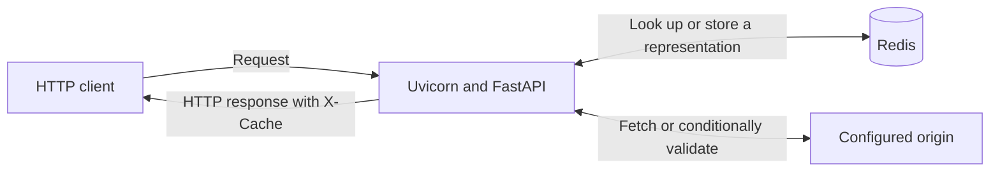

# Caching Proxy Server

A Python reverse proxy that forwards HTTP requests to one configured origin and
shares eligible GET responses through Redis. The response header `X-Cache` lets
you follow a request through a cold fetch, a cache hit, or a refresh.

On the `fastapi` branch, Uvicorn runs the FastAPI proxy by default.
While one request waits for Redis or the origin, the event loop can serve
another request. Add `--backend threaded` to the same startup command to
run the original implementation.

## Run a local demo

Use Python 3.11 or later and Redis 7. The commands below use PowerShell. Run
them from the repository root. On Linux or macOS, create the environment with
`python3 -m venv .venv` and use `.venv/bin/python` and `.venv/bin/caching-proxy`.

**1. Install the project.** The test extra includes pytest.

```powershell
python -m venv .venv
.\.venv\Scripts\python -m pip install -e ".[test]"
```

**2. Start Redis.** If you already have Redis listening on `127.0.0.1:6379`,
use that instance. With Docker Desktop running, create a local Redis container:

```powershell
docker run -d --name caching-proxy-redis -p 127.0.0.1:6379:6379 redis:7
docker exec caching-proxy-redis redis-cli ping
```

Expect `PONG`. To reuse a stopped container of that name, run
`docker start caching-proxy-redis`.

**3. Start the origin and proxy** in separate terminals.

```powershell
# Terminal A: serve the files in this repository on port 9000
.\.venv\Scripts\python -m http.server 9000 --bind 127.0.0.1
```

```powershell
# Terminal B: accept client requests on port 8080 and forward to port 9000
.\.venv\Scripts\caching-proxy --port 8080 --origin http://127.0.0.1:9000
```

**4. Request the same file twice** from a third terminal.

```powershell
$url = "http://127.0.0.1:8080/pyproject.toml?demo=$([guid]::NewGuid())"
curl.exe -sS -D - -o NUL $url
curl.exe -sS -D - -o NUL $url
```

Look for `X-Cache: MISS` followed by `X-Cache: HIT`. The unique query starts
the demo with a cold entry. Terminal A should log only one GET. Use Ctrl+C to
stop the two servers. To clear all proxy entries under the shared
`caching-proxy:` prefix across configured origins, run
`.\.venv\Scripts\caching-proxy --clear-cache`.

## Architecture



- [CLI](proxy_server/cli.py) starts a loopback listener and configures the origin.
- [FastAPI handler](proxy_server/asgi.py) uses asynchronous Redis and HTTP
  connections. Both backends share cache keys, storage format and validation
  rules with the [threaded handler](proxy_server/proxy.py).
- [Cache policy](proxy_server/policy.py) calculates age, freshness, validation
  headers, and the allowed stale window.
- [Redis storage](proxy_server/cache.py) serializes the status, headers, body and
  timing metadata. Redis expiry bounds how long the proxy retains a copy.

## What the client sees

| X-Cache | Meaning |
| --- | --- |
| MISS | The proxy fetched from the origin. Bypassed and streamed origin responses also use this value. |
| HIT | Redis supplied a fresh response. A concurrent request may have waited for another request to populate it. |
| REVALIDATED | The origin returned 304 to the proxy's conditional request. The client receives the stored representation and updated headers. |
| STALE | The origin permitted stale-while-revalidate. The client receives the saved body while one background refresh handles that key. |

The proxy accepts **GET, POST, PUT, and DELETE**. Only eligible GET requests
use the shared cache. Authorization, cookies, request bodies, ranges, client
preconditions, and request `no-cache` or `no-store` cause bypass.

The cache key includes the method, complete origin URL with the original query
string, and the forwarded `Accept`, `Accept-Language`, and `Accept-Encoding`
values. The proxy always keys these three preferences. Responses containing
other `Vary` fields or `Vary: *` bypass storage. Private, no-store and
Set-Cookie responses also bypass storage.

Freshness follows `s-maxage`, then `max-age`, then `Expires`, with a 60-second
fallback for eligible statuses. Age accounts for upstream age and locally
elapsed time. ETag and Last-Modified enable conditional revalidation.
Response `no-cache` requires validation on every reuse. Validator-bearing
entries can remain in Redis for five minutes after expiry to support it.
An explicit stale-while-revalidate window can extend retention. Strict
validation rules take precedence, and requests never extend the grace deadline.

Within a process, simultaneous misses for one key share a lock. Each waiter
rechecks Redis before fetching. Up to four distinct keys can refresh in the
background. On a Redis read failure the request goes directly to the origin.
If a Redis write fails, the client can still receive the origin response.

## Configuration

| Option | Default | Purpose |
| --- | --- | --- |
| `--backend` | fastapi | Select fastapi or threaded |
| `--port` | Required for serving | Listen on this port on 127.0.0.1 |
| `--origin` | Required for serving | HTTP or HTTPS origin URL, optionally including a base path |
| `--origin-timeout` | 10 seconds | Timeout for blocking origin socket operations |
| `--client-timeout` | 10 seconds | FastAPI timeout for upload reads and streamed response sends, or threaded client socket timeout |
| `--max-request-body` | 1,048,576 bytes | Maximum buffered upload size |
| `--max-cache-body` | 1,048,576 bytes | Maximum known-length response size eligible for storage |
| `--clear-cache` | Off | Clear the shared proxy namespace and exit |

Large, unknown-length and uncacheable responses stream from the origin.
Redirects pass through with their Location header. The proxy filters
connection-specific headers, decodes chunked origin responses, and rejects
unsupported chunked uploads. [HTTP handling details](docs/phase-2-http.md)

## Tests and continuous integration

```powershell
.\.venv\Scripts\python -m pytest --require-redis
```

Tests run local HTTP servers on temporary ports. Live Redis tests use random
key prefixes. Set `PROXY_TEST_REDIS_PORT` for a different local test port.
Plain `python -m pytest` reports skipped live checks when Redis is unavailable.
The [GitHub Actions workflow](.github/workflows/tests.yml) runs the strict
suite on pushes and pull requests with a Redis 7 service and Python 3.11 and
3.13. [Test coverage and isolation](docs/phase-5-testing.md)

## Run the benchmark

To repeat the branch comparison, run both commands on the same machine with
Redis running. Each command uses a fresh cache namespace.

```powershell
.\.venv\Scripts\python -m benchmarks.run --backend fastapi --requests 100 --refresh-comparison --output fastapi.json
.\.venv\Scripts\python -m benchmarks.run --backend threaded --requests 100 --refresh-comparison --output threaded.json
```

One Windows loopback run used a 1 KiB response, a 20 ms origin delay, and four
clients per concurrent burst. Mean client latency in milliseconds was:

| Scenario | FastAPI | Threaded |
| --- | ---: | ---: |
| Cold miss | 33.96 | 58.44 |
| Warm hit | 5.17 | 3.69 |
| Concurrent cold requests for the same key | 33.68 | 54.64 |
| Stale response during background refresh | 6.25 | 9.97 |

Both backends made 25 origin calls for 100 concurrent cold requests. See the
[threaded baseline](https://github.com/atharvsalvi/caching-proxy-server/tree/threaded-baseline)
for the original implementation.

```powershell
.\.venv\Scripts\python -m benchmarks.run --refresh-comparison --output my-run.json
```

The runner starts the client, proxy and origin locally and uses a dedicated
Redis prefix. Pass `--backend threaded` to measure the original server under the
same settings. In one earlier threaded Windows run with a 1 KiB response, 20 ms of simulated
origin work and 200 requests per scenario, mean client latency was **32.11 ms
direct**, **69.84 ms on a cold MISS**, and **3.52 ms on a warm HIT**. In the
same run, four-client cold bursts resulted in 50 origin calls for 200 clients.
Host scheduling, network placement and workload shape affect these numbers.
[Methodology, percentiles and raw samples](docs/phase-6-benchmark.md)

## Scope and limitations

- The server is intended for local learning and benchmarking. The listener
  uses HTTP with connection closure. HTTPS can be used on the origin side.
- Per-key coordination works within one Python process. Multiple proxy
  processes sharing Redis can independently fetch the same cold resource.
- Writes pass through. A successful POST, PUT or DELETE can leave a previously
  cached GET visible until expiry or an explicit clear.
- Always keying three preferences can create extra entries. Redis stores body
  bytes as hexadecimal inside JSON, increasing memory use.
- Socket timeouts limit individual blocking operations. A slow transfer can
  take longer than the configured timeout overall.
- The proxy implements a subset of shared HTTP caching, including a bounded
  stale-while-revalidate window. See the [freshness rules](docs/phase-4-freshness.md)
  for precedence, bypass rules and unsupported directives.

For a walkthrough of the design decisions and interview questions, see the
[interview guide](docs/interview-guide.md).
