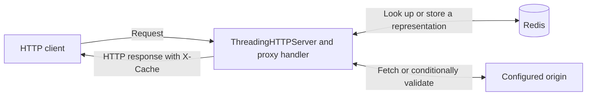

# Caching Proxy Server

A Python reverse proxy that forwards HTTP requests to one configured origin and
shares eligible GET responses through Redis. The response header `X-Cache` lets
you follow a request through a cold fetch, a cache hit, or a refresh.

The threaded baseline on `main` and `threaded-baseline` runs Python's `ThreadingHTTPServer`.
Each client connection gets a thread. When several clients request the same
cold cache key, the first thread fetches the response and the others recheck
Redis after it finishes. The local demo below starts this threaded server.

For the asynchronous implementation and commands to benchmark both backends
with the same workload, see the [FastAPI branch](https://github.com/atharvsalvi/caching-proxy-server/tree/fastapi#run-the-benchmark).

## Run a local demo

Use Python 3.11 or later and Redis 7. The commands below use PowerShell. Run
them from the repository root. On Linux or macOS, create the environment with
`python3 -m venv .venv` and use `.venv/bin/python` and `.venv/bin/caching-proxy`.

**1. Install the project.** The test extra includes pytest.

```powershell
python -m venv .venv
.\.venv\Scripts\python -m pip install -e ".[test]"
```

**2. Start Redis.** If you already have Redis listening on `127.0.0.1:6379`,
use that instance. With Docker Desktop running, create a local Redis container:

```powershell
docker run -d --name caching-proxy-redis -p 127.0.0.1:6379:6379 redis:7
docker exec caching-proxy-redis redis-cli ping
```

Expect `PONG`. To reuse a stopped container of that name, run
`docker start caching-proxy-redis`.

**3. Start the origin and proxy** in separate terminals.

```powershell
# Terminal A: serve the files in this repository on port 9000
.\.venv\Scripts\python -m http.server 9000 --bind 127.0.0.1
```

```powershell
# Terminal B: accept client requests on port 8080 and forward to port 9000
.\.venv\Scripts\caching-proxy --port 8080 --origin http://127.0.0.1:9000
```

**4. Request the same file twice** from a third terminal.

```powershell
$url = "http://127.0.0.1:8080/pyproject.toml?demo=$([guid]::NewGuid())"
curl.exe -sS -D - -o NUL $url
curl.exe -sS -D - -o NUL $url
```

Look for `X-Cache: MISS` followed by `X-Cache: HIT`. The unique query starts
the demo with a cold entry. Terminal A should log only one GET. Use Ctrl+C to
stop the two servers. To clear all proxy entries under the shared
`caching-proxy:` prefix across configured origins, run
`.\.venv\Scripts\caching-proxy --clear-cache`.

## Architecture



- [CLI](proxy_server/cli.py) starts a loopback listener and configures the origin.
- [Request handler](proxy_server/proxy.py) forwards requests, matches variants,
  coordinates concurrent misses, and streams bodies.
- [Cache policy](proxy_server/policy.py) calculates age, freshness, validation
  headers, and the allowed stale window.
- [Redis storage](proxy_server/cache.py) serializes the status, headers, body and
  timing metadata. Redis expiry bounds how long the proxy retains a copy.

## What the client sees

| X-Cache | Meaning |
| --- | --- |
| MISS | The proxy fetched from the origin. Bypassed and streamed origin responses also use this value. |
| HIT | Redis supplied a fresh response. A concurrent request may have waited for another thread to populate it. |
| REVALIDATED | The origin returned 304 to the proxy's conditional request. The client receives the stored representation and updated headers. |
| STALE | The origin permitted stale-while-revalidate. The client receives the saved body while one background refresh handles that key. |

The proxy accepts **GET, POST, PUT, and DELETE**. Only eligible GET requests
use the shared cache. Authorization, cookies, request bodies, ranges, client
preconditions, and request `no-cache` or `no-store` cause bypass.

The cache key includes the method, complete origin URL with the original query
string, and the forwarded `Accept`, `Accept-Language`, and `Accept-Encoding`
values. The proxy always keys these three preferences. Responses containing
other `Vary` fields or `Vary: *` bypass storage. Private, no-store and
Set-Cookie responses also bypass storage.

Freshness follows `s-maxage`, then `max-age`, then `Expires`, with a 60-second
fallback for eligible statuses. Age accounts for upstream age and locally
elapsed time. ETag and Last-Modified enable conditional revalidation.
Response `no-cache` requires validation on every reuse. Validator-bearing
entries can remain in Redis for five minutes after expiry to support it.
An explicit stale-while-revalidate window can extend retention. Strict
validation rules take precedence, and requests never extend the grace deadline.

Within a process, simultaneous misses for one key share a lock. Each waiter
rechecks Redis before fetching. Up to four distinct keys can refresh in the
background. On a Redis read failure the request goes directly to the origin.
If a Redis write fails, the client can still receive the origin response.

## Configuration

| Option | Default | Purpose |
| --- | --- | --- |
| `--port` | Required for serving | Listen on this port on 127.0.0.1 |
| `--origin` | Required for serving | HTTP or HTTPS origin URL, optionally including a base path |
| `--origin-timeout` | 10 seconds | Timeout for blocking origin socket operations |
| `--client-timeout` | 10 seconds | Timeout for blocking client socket operations |
| `--max-request-body` | 1,048,576 bytes | Maximum buffered upload size |
| `--max-cache-body` | 1,048,576 bytes | Maximum known-length response size eligible for storage |
| `--clear-cache` | Off | Clear the shared proxy namespace and exit |

Large, unknown-length and uncacheable responses stream in reads of up to
64 KiB. Redirects pass through with their Location header. The proxy filters
connection-specific headers, decodes chunked origin responses, and rejects
unsupported chunked uploads. [HTTP handling details](docs/phase-2-http.md)

## Tests and continuous integration

```powershell
.\.venv\Scripts\python -m pytest --require-redis
```

Tests run local HTTP servers on temporary ports. Live Redis tests use random
key prefixes. Set `PROXY_TEST_REDIS_PORT` for a different local test port.
Plain `python -m pytest` reports skipped live checks when Redis is unavailable.
The [GitHub Actions workflow](.github/workflows/tests.yml) runs the strict
suite on pushes and pull requests with a Redis 7 service and Python 3.11 and
3.13. [Test coverage and isolation](docs/phase-5-testing.md)

## Latency report

On the threaded proxy, a warm cache hit averaged **3.52 ms**, compared with
**32.11 ms** for a direct origin request. A first request for a new URL averaged
**69.84 ms** through the proxy. In this workload, the latency benefit came from
reusing a response after the first fetch.

### What was measured

The November 12, 2026 runs used Windows 11, Python 3.13.4, and Redis 7.4.12
in Docker Desktop. The client, threaded proxy, and HTTP origin ran on the same
machine. The origin waited 20 ms per request and served a 1 KiB body. Each
client timer covered opening a new connection through reading the last byte.
The runner checked the status, body, cache outcomes, and origin request count.

### Fresh and cold entries

Each row contains 200 timed requests. The first three scenarios sent one
request at a time. The last sent 50 bursts of four clients, each burst asking
for the same new URL. The warm-hit row excludes the initial cache fill.

| Scenario | Mean (ms) | p50 (ms) | p95 (ms) | p99 (ms) | Requests/s | Origin calls |
| --- | ---: | ---: | ---: | ---: | ---: | ---: |
| Direct to origin | 32.11 | 33.25 | 45.40 | 47.58 | 31.12 | 200 |
| Cold MISS | 69.84 | 68.03 | 85.76 | 100.00 | 14.32 | 200 |
| Warm HIT | 3.52 | 1.59 | 17.49 | 24.42 | 283.42 | 0 |
| Four clients, same cold URL | 59.73 | 63.39 | 70.22 | 71.63 | 65.26 | 50 |

A typical warm hit took **1.59 ms** (the median, or p50), and 95% finished
within **17.49 ms**. A cold miss included Redis lookups, the origin fetch, and
a cache write. In the four-client bursts, one thread fetched each URL and the
others reused it. That produced 50 misses and 150 hits. A request recorded as
a hit could still spend most of its time waiting for the first fetch.
[Per-request timings and environment](benchmarks/sample-run.json)

### When a cached response expires

A second run primed 50 URLs with an ETag and immediate expiry. Four clients
then requested each URL together. In blocking mode the first client waited
for the origin to validate the saved response. In background mode the origin
allowed the proxy to serve the saved response for up to 10 seconds after
expiry while it checked for an update.

| Refresh behavior | Mean (ms) | p50 (ms) | p95 (ms) | p99 (ms) | Origin validations | Client outcomes |
| --- | ---: | ---: | ---: | ---: | ---: | --- |
| Wait for validation | 58.30 | 61.79 | 69.56 | 71.01 | 50 | 50 REVALIDATED, 150 HIT |
| Serve stale during refresh | 12.18 | 4.30 | 28.84 | 30.53 | 50 | 200 STALE |

Background refresh saved clients **46.12 ms on average** with the same number
of origin validations. Clients could receive an older body during that window.
The runner waited for each refresh to finish and verified a fresh hit before
the next burst. Those checks and the initial cache fills were outside the
timed requests. [Per-request refresh timings](benchmarks/stale-refresh-run.json)

### Threaded versus FastAPI

A separate Windows comparison used 100 requests per scenario with the same
body size, origin delay, and burst size. Both columns below are **mean client
latency in milliseconds** from that comparison.

| Scenario | Threaded | FastAPI |
| --- | ---: | ---: |
| Cold MISS | 58.44 | 33.96 |
| Warm HIT | 3.69 | 5.17 |
| Four clients, same cold URL | 54.64 | 33.68 |
| Serve stale during refresh | 9.97 | 6.25 |

The threaded server had the lower mean for warm hits in this run. FastAPI had
the lower mean for cold requests and background refresh. Both made 25 origin
calls for 100 clients in the cold bursts. These are local measurements with
fresh connections and a fixed origin delay. Deployment latency and throughput
depend on network distance, connection reuse, and the actual mix of requests.
[Backend comparison and commands](https://github.com/atharvsalvi/caching-proxy-server/tree/fastapi#run-the-benchmark)

### Reproduce the threaded measurements

With Redis running on port 6379, run this from the repository root. The
runner starts the origin and proxy on temporary ports, uses a dedicated Redis
prefix, and writes individual request times and summaries to the JSON file.

```powershell
.\.venv\Scripts\python -m benchmarks.run --requests 200 --workers 4 --delay-ms 20 --refresh-comparison --output my-run.json
```

Throughput uses completed requests divided by elapsed wall time, so concurrent
requests can overlap. With 200 samples, p99 is the 198th sorted time and can
shift between runs. [Benchmark methodology](docs/phase-6-benchmark.md)

## Scope and limitations

- The server is intended for local learning and benchmarking. The listener
  uses HTTP with connection closure. HTTPS can be used on the origin side.
- Per-key coordination works within one Python process. Multiple proxy
  processes sharing Redis can independently fetch the same cold resource.
- Writes pass through. A successful POST, PUT or DELETE can leave a previously
  cached GET visible until expiry or an explicit clear.
- Always keying three preferences can create extra entries. Redis stores body
  bytes as hexadecimal inside JSON, increasing memory use.
- Socket timeouts limit individual blocking operations. A slow transfer can
  take longer than the configured timeout overall.
- The proxy implements a subset of shared HTTP caching, including a bounded
  stale-while-revalidate window. See the [freshness rules](docs/phase-4-freshness.md)
  for precedence, bypass rules and unsupported directives.

For a walkthrough of the design decisions and interview questions, see the
[interview guide](docs/interview-guide.md).
